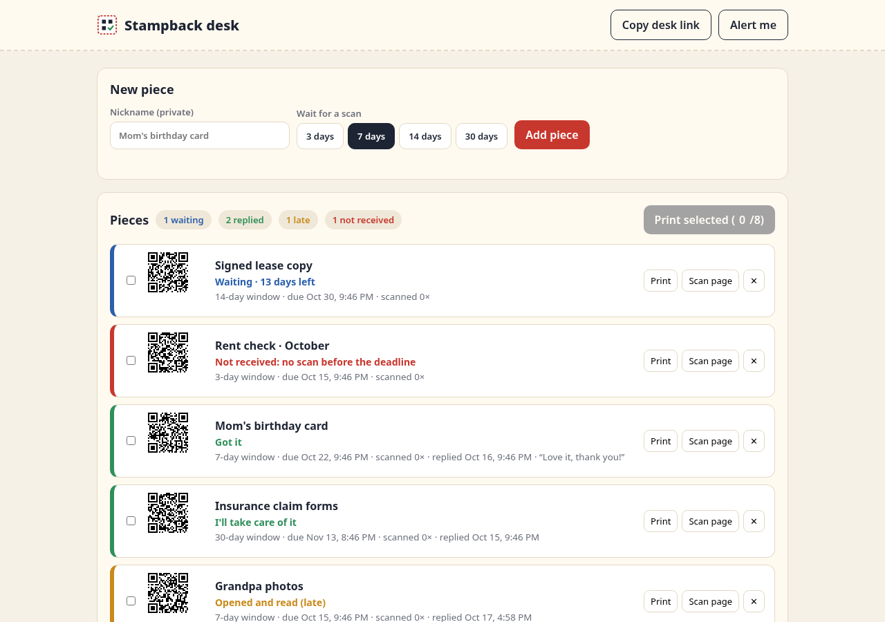
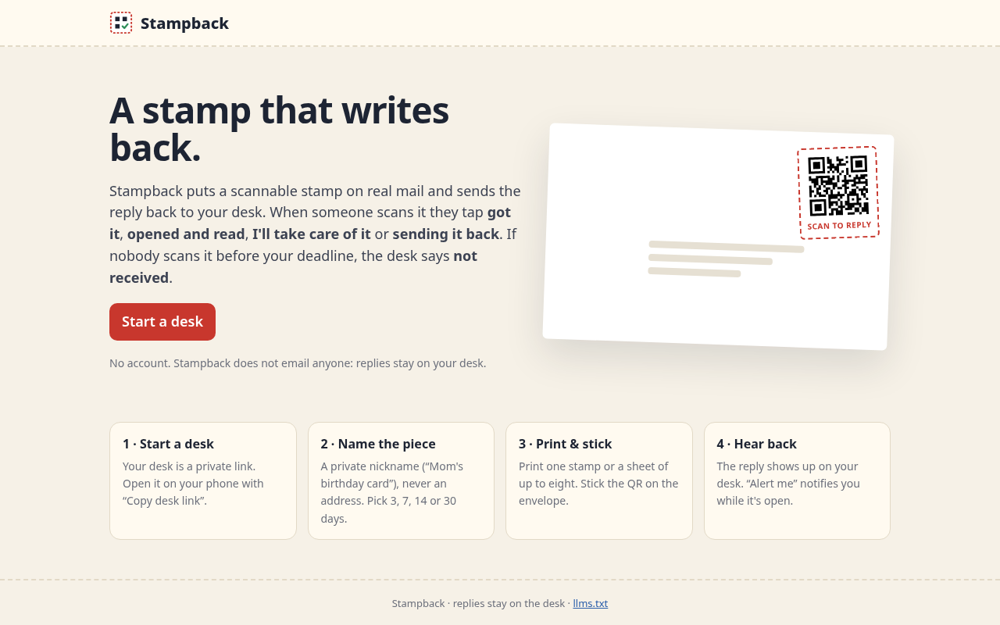
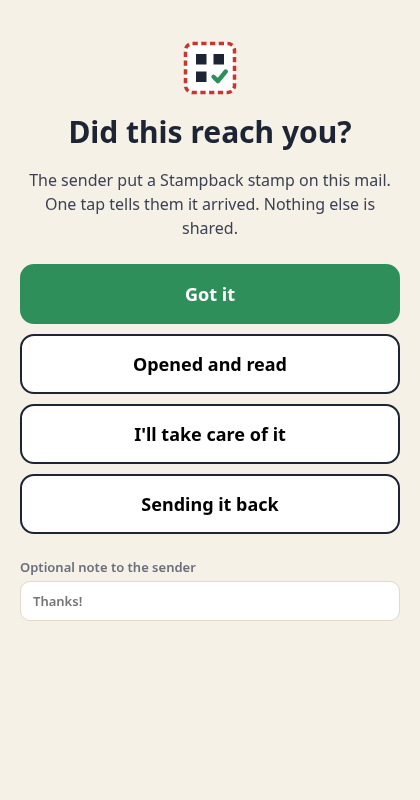

# Stampback

**Repo:** https://github.com/fitzyracing1/stampback

**A stamp that writes back.** Stampback puts a scannable QR stamp on real mail. When someone scans it, they tap a reply (got it, opened and read, I'll take care of it, sending it back) and the reply shows up on your desk. If the deadline passes with no scan, the desk says **not received**. Late replies still arrive.



| Home | Scan page (recipient's phone) |
|---|---|
|  |  |

## How it works

1. **Start a desk.** No account: a desk is a private link (`/desk.html#<id>.<key>`). **Copy desk link** opens the same desk on your phone. The browser remembers your desk.
2. **Name the piece** with a private nickname (Stampback rejects things that look like an email or street address) and pick how long to wait: **3, 7, 14 or 30 days**.
3. **Print** one stamp, or tick up to **eight** pieces and print them as one sheet. Nicknames are never printed; the QR holds only an unguessable stamp URL (`/s/<stamp>`).
4. **Scan.** The recipient's phone camera opens the scan page. One tap sends the reply (with an optional note). The scanner never sees your nickname or desk.
5. **Desk.** Each piece shows Waiting (days left) → Got it / Opened and read / I'll take care of it / Sending it back, or **Not received** once the deadline passes. Replies after the deadline are marked late. The desk updates live (Server-Sent Events) and **Alert me** shows a browser notification while the desk is open.

**Stampback does not email anyone.** Replies stay on the desk.

## Run it

Zero dependencies, Node 18+.

```sh
npm start                          # http://localhost:8080
PUBLIC_URL=http://192.168.1.20:8080 npm start   # origin printed in QR codes, so phones on your LAN can scan
npm test                           # node --test: core rules + HTTP API round trip
docker build -t stampback . && docker run -p 8080:8080 -v stampback:/data stampback
```

Environment: `PORT` (8080), `DATA` (`./data/stampback.json`), `PUBLIC_URL` (defaults to the request host).

API: `POST /api/desks`, `GET /api/desks/:id?key=`, `POST /api/desks/:id/pieces?key=` `{name, days}`, `DELETE /api/desks/:id/pieces/:piece?key=`, `GET /api/desks/:id/events?key=` (SSE), `GET /api/stamps/:stamp`, `POST /api/stamps/:stamp/reply` `{kind, note}`.

## Search engines (from the chat)

- Homepage carries `<meta name="google-site-verification" content="V6vcuK3GPyoYOaEMai4qHA1-TxKsL6ql11XR8qoOnX4">` (the last tag used in the chat) and is indexable. `public/google52ab61f0b5e00b30.html` is the file-method token.
- `/sitemap.xml` and the `Sitemap:` line in `/robots.txt` are generated with the live origin (`PUBLIC_URL`), so they are valid absolute URLs. `/llms.txt` describes the product for AI crawlers.
- Desk, print, scan and API responses are `noindex` (header + meta) and disallowed in robots.txt.
- Verification only works on the public HTTPS address: use a **URL-prefix** property in Search Console (a Domain property needs a DNS TXT record), choose "HTML tag", verify, then submit `/sitemap.xml`.

## Choices and limits

- Needs a small server (it records scans from other people's phones), so it is not a GitHub Pages site. Any Node host or the Dockerfile works.
- Storage is one JSON file with atomic writes; fine for personal use, not for heavy multi-user load.
- The desk key in the URL is the only credential; keep the desk link private.
- `Alert me` uses the Notification API and only fires while a desk tab is open (no push service, no email).

## Origin

Built from Joshua Almeida's Grok chat "QR Mail Scan Auto-Reply" (https://grok.com/c/3d197800-da6f-42f2-9555-45a85118b6c0, Sep 22, 2026).

## License

MIT, see [LICENSE](LICENSE). Bundles `public/vendor/qrcode.js` (qrcode-generator, © Kazuhiko Arase, MIT).
